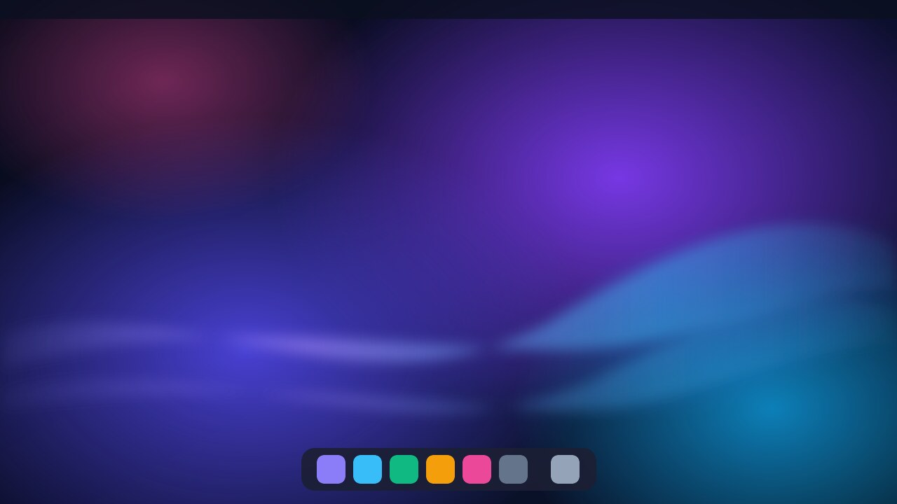

<p align="center">
  
</p>

<h1 align="center">M OS</h1>
<p align="center"><b>Your Computer. Your Experience. Your OS.</b></p>
<p align="center">
  A desktop operating system built on <b>Debian 13</b> and <b>KDE Plasma 6</b>, with its own design,
  desktop layouts, system applications, security baseline, and graphical installer.
</p>

<p align="center">
  <a href="../../actions/workflows/test.yml"></a>
  <a href="../../actions/workflows/build-iso.yml"></a>
</p>

> **Status: 0.1 developer preview.** Boots as a live system and has a real
> installer path. **Not production-ready.** Try it in a virtual machine first.
> Back up your data before installing on real hardware. See [Test status](#test-status).

<p align="center"></p>

*The image above shows the layout concept. Real screenshots from automated VM
boot tests are attached to each CI run and release.*

## What M OS is

M OS is a **Linux distribution**. It does not write a new kernel or desktop.
It builds on maintained components and adds its own identity and tools:

| Component | M OS implementation |
|---|---|
| Core | Debian 13 "trixie", amd64, Debian kernel (`linux-image-amd64`) |
| Desktop | KDE Plasma 6 (Wayland default, X11 session available), M OS defaults |
| Layouts | **M OS Modern** (top bar + centred floating dock) and **M OS Classic** (taskbar + start menu). Both are real Plasma global themes with layout scripts. |
| Themes | M OS Dark / M OS Light colour schemes, accent colour manager, Aurora wallpapers (auto light/dark), Papirus icons, Inter font |
| File manager | Dolphin (tabs, search, archives, NTFS/exFAT, external drives) |
| App store | KDE Discover with signed Debian repositories (+ fwupd firmware updates) |
| Settings | **M OS Control Center** — 17 sections. Native M OS settings plus KDE modules for hardware. |
| Updates | **M OS Update Center** — APT via polkit helper, live progress, security updates highlighted, restart detection |
| Welcome | **M OS Welcome** — layout, theme, accent, performance profile, privacy, live-session installer button |
| Monitoring | **M OS System Monitor** (CPU/RAM/disk/network graphs, processes, sensors, battery) and **M OS About** |
| Terminal | Konsole |
| Installer | Calamares 3.3 (Debian package) with M OS branding, offline bootloader pool, 8+ character passwords |
| Security | ufw firewall on (deny incoming), AppArmor + profiles, no SSH, sysctl hardening, auto screen lock, no telemetry |
| Performance | zram swap (zstd), **M OS Performance** profile for 4–8 GB RAM |
| Languages | English + Sinhala: fonts, `si_LK` locale, Wijesekara and Singlish input (Fcitx 5) |
| Boot | GRUB for BIOS + UEFI (Debian-signed shim/GRUB), branded menu, Plymouth splash |

## Download

Builds are published on the [Releases page](../../releases). Each release
includes the ISO (split into parts if larger than 2 GiB), `SHA256SUMS`,
`BUILD-REPORT.md`, and boot-test reports. Every CI run of
[Build ISO](../../actions/workflows/build-iso.yml) also uploads the ISO as an
artifact.

## System requirements

| | Minimum | Recommended |
|---|---|---|
| CPU | 64-bit x86 (amd64), 2 cores | 4 cores (e.g. Intel Core i5-6500) |
| RAM | 4 GB (use the M OS Performance profile) | 8 GB |
| Disk | 20 GB | 64 GB SSD |
| Graphics | Any with a kernel driver; `safe graphics` boot option for problem GPUs | Intel HD 530 or newer, AMD GCN+ |
| Firmware | UEFI or legacy BIOS | UEFI |

**Primary target machine:** Intel Core i5-6500, 8 GB DDR4, Intel HD Graphics 530,
SATA SSD. **Real-hardware testing on this machine has not been done yet.** See
[docs/hardware-compatibility.md](docs/hardware-compatibility.md).

## Quick start

```bash
# Try in QEMU (UEFI). Add --bios for legacy BIOS, --disk 30G for a disposable install disk
./scripts/run-vm.sh M-OS-0.1.0-amd64.iso
```

Live session user: `mos`, password `live`. For USB creation and installation, see
**[docs/installation.md](docs/installation.md)**.

## Build it yourself

You need a Debian 13 host (or `debian:trixie` container), about 25 GB free disk, and root:

```bash
sudo apt install live-build debootstrap xorriso squashfs-tools mtools dosfstools \
  grub-pc-bin grub-efi-amd64-bin dpkg-dev debhelper dh-python lintian rsync shellcheck \
  python3-pyqt6 desktop-file-utils
sudo ./scripts/build-iso.sh          # → dist/M-OS-<version>-amd64.iso, SHA256SUMS, BUILD-REPORT.md
tests/boot/boot-test.sh dist/M-OS-*-amd64.iso   # automated QEMU boot test (BIOS + UEFI)
```

For more, see [docs/developer-guide.md](docs/developer-guide.md) and [docs/architecture.md](docs/architecture.md).

## Test status

M OS keeps **implemented**, **tested**, and **planned** separate. The latest
results are in [`tests/reports/`](tests/reports/) and on each CI run.

| Area | Implemented | Automated test |
|---|---|---|
| Config validation, shellcheck, package availability (152 packages) | ✅ | ✅ CI `Test` |
| Unit tests (parsers, APT, desktopctl) | ✅ | ✅ 20 tests |
| Debian packages build + lintian + content tests | ✅ | ✅ |
| M OS apps open and render against real `/proc`/`/sys` (offscreen Qt) | ✅ | ✅ GUI smoke test |
| ISO build + structure verification | ✅ | ✅ `verify-iso.sh` |
| Live boot via UEFI and BIOS to Plasma desktop, in-system checks | ✅ | see `tests/reports/` |
| Graphical installation onto a virtual disk | ✅ (Calamares) | ⏳ manual procedure, not yet automated |
| Real hardware (i5-6500 / HD 530) | — | ❌ not tested yet |
| Secure Boot with enrolled keys | configured | ❌ not verified |
| Sinhala UI translation | partial | ❌ not reviewed |

Known problems: [docs/known-issues.md](docs/known-issues.md).

## Roadmap

| Version | Goal |
|---|---|
| **0.1** (now) | Bootable ISO, M OS desktop + apps, Calamares installer, CI build + boot tests |
| 0.2 | Automated installer test on virtual disks, first real-hardware reports, Plasma layout polish from real screenshots |
| 0.5 | Full Sinhala translation via Qt Linguist, Secure Boot verification, M OS repository (APT) for M OS package updates, Flatpak/Flathub opt-in |
| 1.0 | Stable release after a full QA cycle on a published hardware matrix |

## Documentation

[Architecture](docs/architecture.md) · [Installation](docs/installation.md) ·
[Hardware compatibility](docs/hardware-compatibility.md) · [Security](docs/security.md) ·
[Localisation](docs/localisation.md) · [Developer guide](docs/developer-guide.md) ·
[Troubleshooting](docs/troubleshooting.md) · [Known issues](docs/known-issues.md) ·
[Changelog](CHANGELOG.md)

## License

* M OS code, scripts, and packaging: **GPL-3.0-or-later** ([LICENSE](LICENSE)).
* M OS artwork: **CC-BY-SA-4.0** ([branding/LICENSE](branding/LICENSE)).
* Bundled Debian packages keep their own licenses (`/usr/share/doc/<package>/copyright`).
* M OS is not affiliated with Debian, KDE, Apple, or Microsoft. Debian and KDE are trademarks of their owners.
