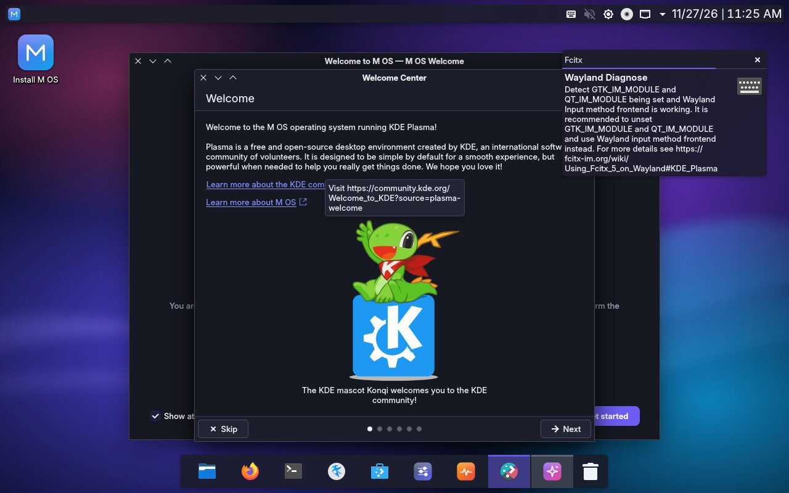

# Test reports

These are real results only. Each folder holds the raw report written by the test tool.

## 2026-11-27: CI run 45946526758, commit `6de819b`

GitHub Actions `ubuntu-24.04` runner. The ISO was built in a `debian:trixie`
container (14 min). Boot test under QEMU/KVM, 4 GB RAM, 2 vCPU, full desktop mode.

| Firmware | Result | Boot → login prompt | Boot → Plasma desktop | systemd startup | RAM used, idle live desktop |
|---|---|---|---|---|---|
| UEFI (OVMF) | **PASS** (21/21 required) | 43.6 s | 54.0 s (Wayland) | 15.9 s | 1711 MB |
| BIOS (SeaBIOS) | **PASS** (21/21 required) | 45.0 s | 50.4 s (Wayland) | 12.5 s | 1678 MB |

Details: [`boot-uefi.md`](2026-11-27-ci-6de819b/boot-uefi.md), [`boot-bios.md`](2026-11-27-ci-6de819b/boot-bios.md).

**Problems found by this run (fixed in later commits):**

| Problem | Fix | Commit |
|---|---|---|
| KDE `plasma-welcome` opened on top of M OS Welcome (+338 MB RAM) | purged in hook 0300, verified in 9100. Confirmed in CI run 45949262949: idle RAM 1711 → 1486 MB | `8576997` |
| Fcitx "Wayland Diagnose" warning: im-config set `GTK_IM_MODULE`/`QT_IM_MODULE` on Wayland | first attempt (plasma-workspace env script) was ineffective, as shown by the next CI run; fixed with `/etc/profile.d/00-mos-input.sh` | `8576997`, then the next commit |
| zram check failed because `swapon` was not in the live user's PATH (test bug, zram state unknown) | test uses `/usr/sbin/swapon` | `8576997` |
| GRUB menu: selected entry hard to see | rounded highlight pixmaps | `6699bec` |

*The screenshot shows the state before the fixes above: the KDE Welcome
window and the Fcitx warning are visible.*

## 2026-11-27: local sandbox, TCG (no KVM), 1.1–1.4 GB RAM

[`2026-11-27-local-tcg-uefi.md`](2026-11-27-local-tcg-uefi.md)

| Check | Result |
|---|---|
| UEFI boot to login prompt (software emulation) | PASS: 193–195 s |
| Live user login | PASS |
| UEFI firmware detected | PASS |
| SDDM active | PASS |
| `/etc/os-release` = M OS | **FAIL**: led to the fix in `4077839` (verified PASS in CI run above) |
| Plasma desktop | not reached: the 1.9 GB host ran out of memory (host OOM killer) |

## Not tested yet

* Installation with Calamares (manual procedure in [`docs/testing.md`](../../docs/testing.md))
* Real hardware, including the Intel i5-6500 / HD 530 target
* Secure Boot with enrolled keys
